<p align="center">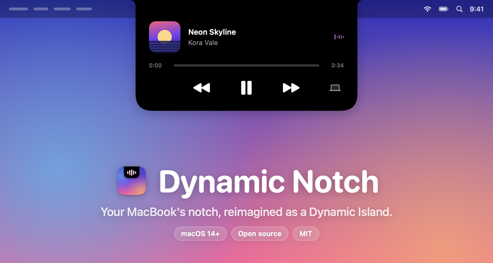</p>

<p align="center">
  <a href="https://github.com/ahududu1881/DynamicNotch/releases"></a>
  
  
  <a href="LICENSE"></a>
  <a href="https://github.com/ahududu1881/DynamicNotch/actions/workflows/ci.yml"></a>
</p>

<p align="center"><a href="README.md">English</a> · <b>Türkçe</b> · <a href="PLUGINS.tr.md">Eklenti kılavuzu</a> · <a href="CHANGELOG.md">Değişiklikler</a></p>

MacBook notch'unu Dynamic Island'a çeviren menü çubuğu uygulaması. macOS 14 veya üstü gerekir. Notch'lu MacBook'lar için yapıldı; diğer Mac'lerde ekranın üstünde sanal bir notch çizilir.

## Kurulum

[Releases](../../releases) sayfasındaki **DynamicNotch-1.0.0.dmg** dosyasını aç, **Dynamic Notch**'i **Uygulamalar** kısayoluna sürükle. Uygulama Apple tarafından
notarize edilmediği için ilk açılışta Uygulamalar'da sağ tık → **Aç** demen gerekebilir.

Ya da kaynaktan derle (Xcode komut satırı araçları yeter):

```bash
./scripts/build.sh && open "build/Dynamic Notch.app"
```

İzinler: **Erişilebilirlik** (ses/parlaklık tuşlarını yakalamak için), **Tam Disk Erişimi** (bildirimleri ve Odak modunu okumak için, isteğe bağlı).
Music/Spotify AppleScript kullanılırsa ayrıca Otomasyon izni sorulur. Hiçbiri verilmezse uygulama yine çalışır, yalnızca ilgili özellikler kapalı kalır.

Verilerin Mac'inden çıkmaz, analitik yoktur. Tek ağ erişimi, Music/Spotify betik kipinde albüm kapağı aramasıdır (Spotify'ın kapak adresi, Apple'ın herkese açık iTunes Search servisi; sanatçı ve şarkı adı gider) ve onayladığın eklentilerin istekleridir.

## Hareket halinde

<p align="center">
  <a href="https://github.com/ahududu1881/DynamicNotch/blob/main/docs/promo.mp4">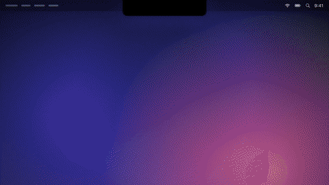</a>
</p>
<p align="center"><a href="https://github.com/ahududu1881/DynamicNotch/blob/main/docs/promo.mp4"><b>▶ 60 saniyelik filmin tamamını izle</b></a> (1080p, sesli)</p>

## Özellikler

<table>
  <tr>
    <td>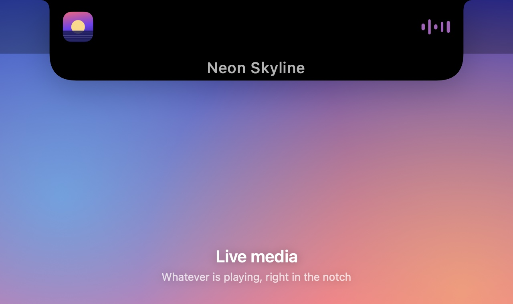</td>
    <td>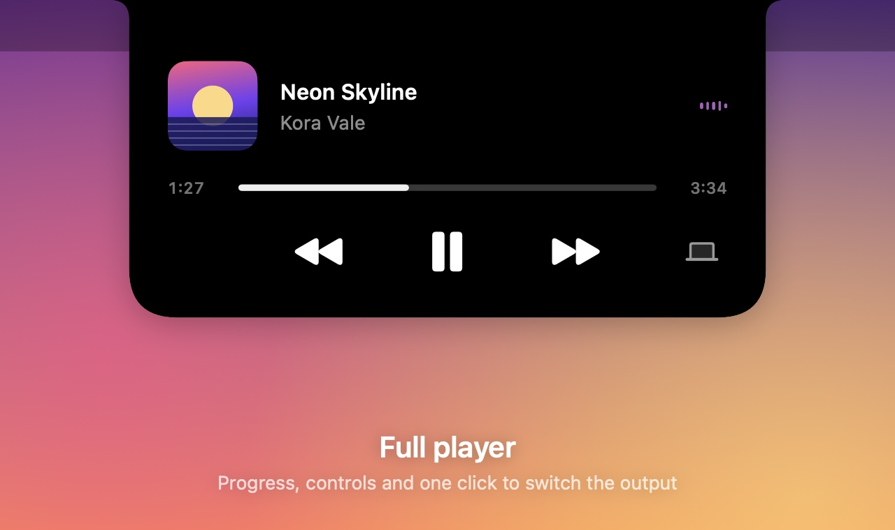</td>
    <td>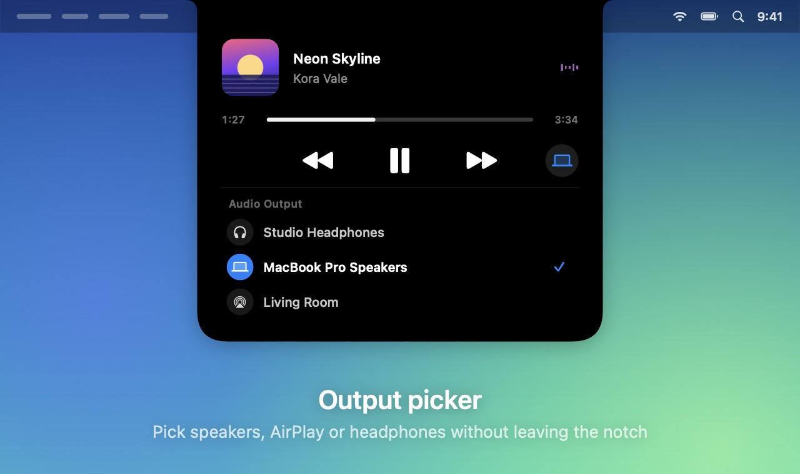</td>
  </tr>
  <tr>
    <td>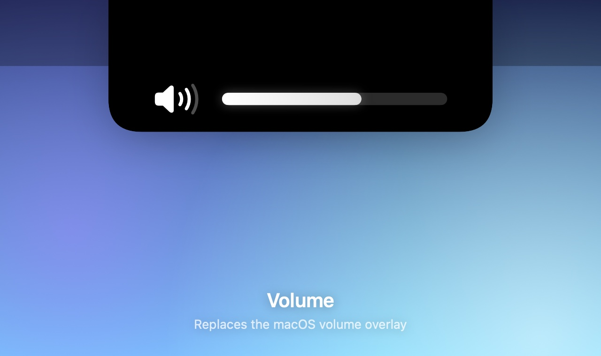</td>
    <td>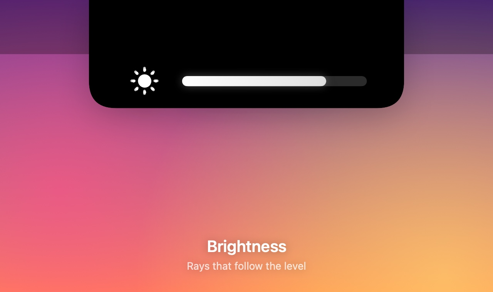</td>
    <td>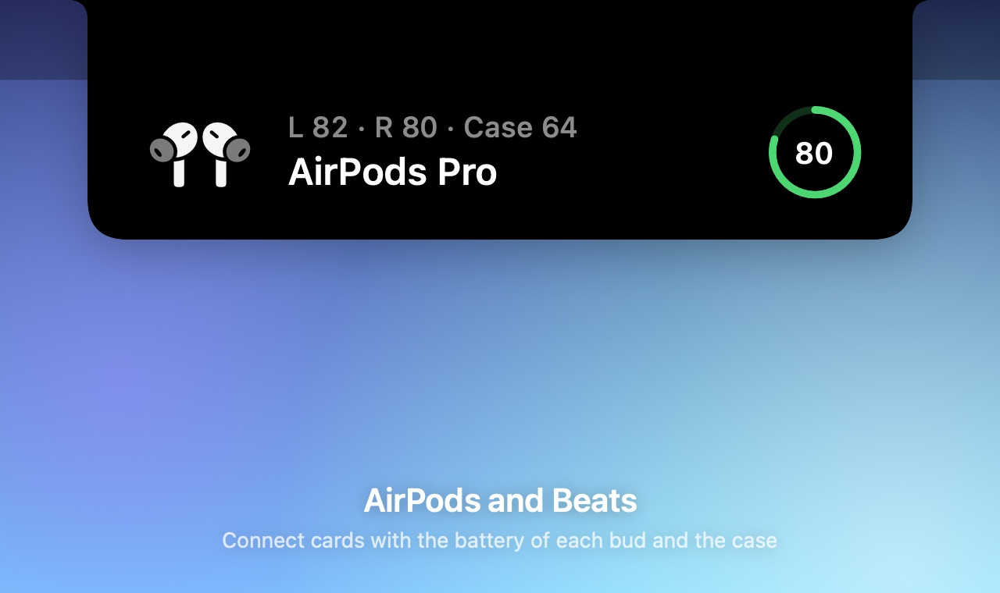</td>
  </tr>
  <tr>
    <td>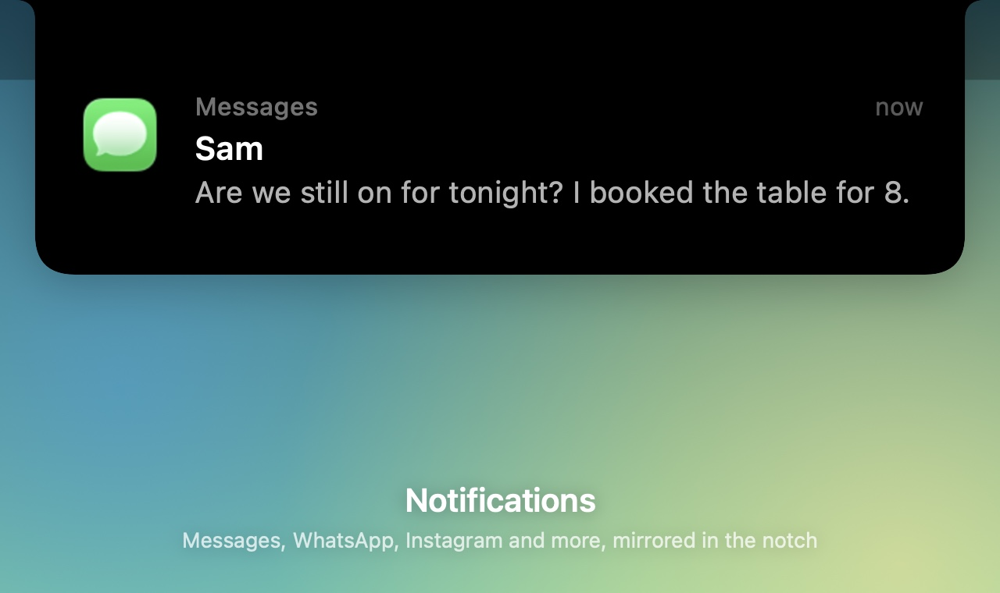</td>
    <td>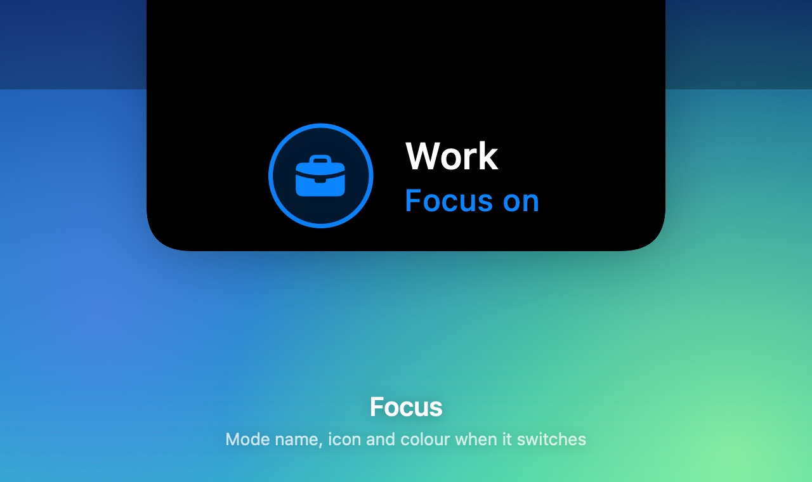</td>
    <td>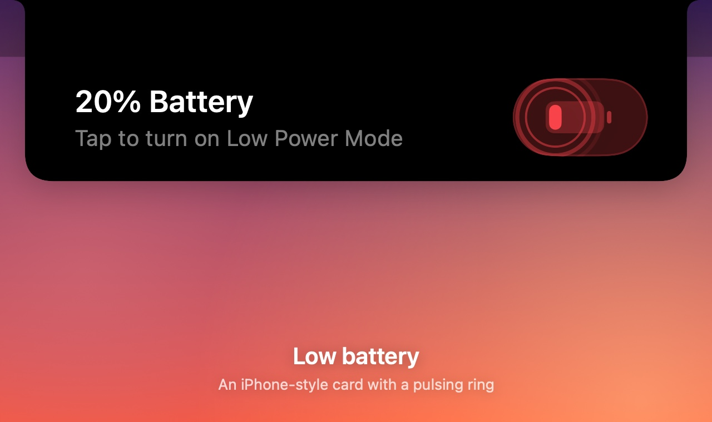</td>
  </tr>
  <tr>
    <td>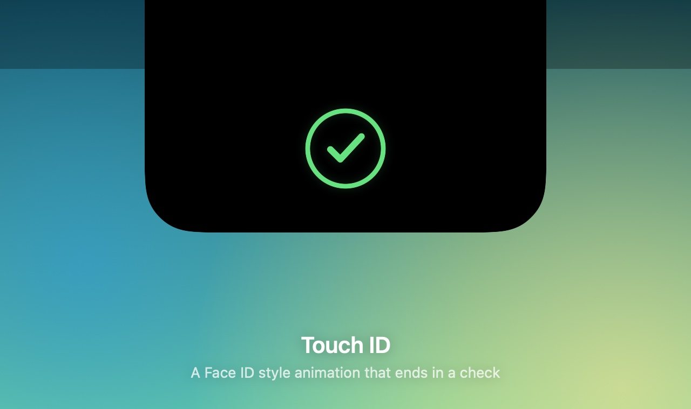</td>
    <td>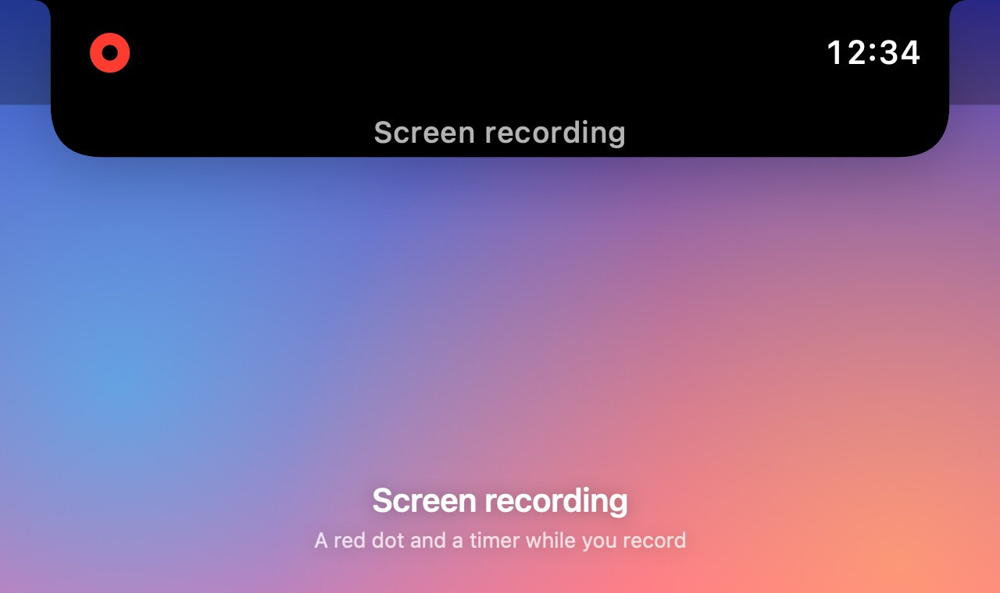</td>
    <td>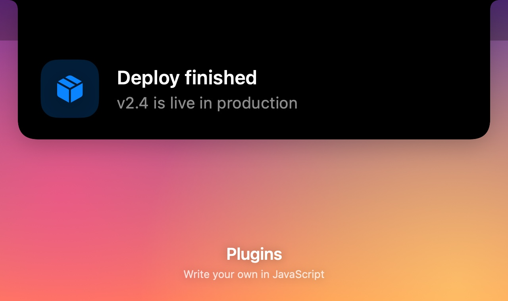</td>
  </tr>
</table>

- **Canlı medya:** Sistem genelindeki medya (Spotify, Music, tarayıcı/YouTube...) yatay açılan pill'de; üstüne basınca tam oynatıcı (ilerleme, kontroller, ses çıkışı seçici).
- **Ses / parlaklık / medya tuşları:** macOS göstergesi yerine notch'ta; büyük oynatıcı açıkken altından büyüyerek gösterilir.
- **Bildirim kuyruğu:** Öncelikli, aynı kanalı yerinde güncelleyen, sınırlı kuyruk. Ses/parlaklık her şeyin önüne geçer, yarım kalan bildirim sonra devam eder.
- **Aktiviteler ve zamanlayıcılar:** Başka uygulamaların kalıcı göstergeleri (indirme, build...) ve geri sayım; medya yokken pill'de görünür.
- **AirPods / Bluetooth kulaklık:** Bağlanınca ve çıkınca model ikonuyla (AirPods, Pro, Max, 3, 4...) kısa bir şerit; pil seviyesi (sol/sağ/kutu) bir an sonra yerinde eklenir.
- **Tam ekran:** Notch gizli kalır; ses, parlaklık, Odak, kulaklık ve çıkış değişimi gibi sistem durumları kısa süre görünür ve kapanır. Tuşlar bu sırada da notch'a yönlendirilir.
- **Odak modları:** Açılıp kapanınca notch'ta modun adı, ikonu ve rengiyle kısa bir şerit (Tam Disk Erişimi gerekir). Medya pill'i açıkken pill korunur, altına satır eklenir. Odak sırasında bildirimlerin gösterilip gösterilmeyeceği ayardan seçilir.
- **Uyumluluk:** Ayarlar > "Uyumluluk ve sağlık" her bağımlılığın durumunu gösterir (`GET /v1/diagnostics`, `Raporu kopyala`). macOS güncellenince açılışta otomatik kontrol edilir; bozulan bir şey varsa notch'ta uyarı çıkar. Medya köprüsü çökerse Music/Spotify'a otomatik geçilir; bildirim veritabanı ve Odak dosyalarının biçimi değişirse çökmek yerine "sağlık"ta raporlanır.
- **Hareketler:** Notch üstünde yukarı/aşağı kaydır = ses; oynatıcıda sağa/sola kaydır = şarkı atla. Üzerine gelince aç (ayardan).
- **Kısayollar:** ⌃⌥ + Boşluk (oynat/duraklat), ← → (önceki/sonraki), ↑ ↓ (ses), N (oynatıcıyı aç/kapat).
- **Ayarlar penceresi** (menü çubuğu simgesi → Ayarlar): dil, Dock'ta gösterme, menü çubuğu simgesi, hız, süreler, hangi bildirimler, izinler, eklentiler, API...
- **Dayanıklılık:** Tam ekranda gizlenir ve tuşları serbest bırakır; uyku/uyanma, ekran değişimi ve izin kaybında kendini toparlar; köprü çökerse yeniden başlar.

## Test

```bash
swift test               # 170+ birim testi (HTTP ayrıştırıcı, API doğrulama, bildirim kuyruğu, medya durumları, ayarlar, eklentiler)
python3 scripts/stress.py  # çalışan uygulamaya hatalı/saldırgan trafik ve 1400+ eşzamanlı istek
```

## Eklentiler

Kendi eklentini JavaScript ile yazıp notch'a ekleyebilirsin: toast, kart, kalıcı gösterge, zamanlayıcı göstermek;
medya, ses, Odak, pil, AirPods, ekran kaydı, Touch ID olaylarına tepki vermek; isteğe bağlı internet, komut çalıştırma
ve medya kontrolü. Her eklenti yalıtılmış çalışır, izin isteyenler onay ister, kod değişirse yeniden sorulur.

Hızlı başlangıç: **Ayarlar → Eklentiler → Örnek eklentileri ekle**, ya da
`~/Library/Application Support/DynamicNotch/Plugins/` altına `plugin.json` + `main.js` koy.
Tam kılavuz ve API listesi: [PLUGINS.md](PLUGINS.md).

```js
notch.on("media", function (m) {
  if (m.changed === "track") notch.toast({ text: m.title, symbol: "music.note" });
});
```

## Yerel HTTP API (isteğe bağlı)

Eklentiler çoğu iş için yeterlidir; bu yüzden HTTP sunucusu varsayılan olarak **kapalıdır**
(Ayarlar → API). Dışarıdaki bir betikten (curl, başka bir uygulama) notch'u tetiklemek istersen aç.

Uygulama `127.0.0.1:39283` üzerinde JSON konuşan küçük bir HTTP API açar (port için: `defaults write com.dynamicnotch.app apiPort 40000`).
Yalnızca bu Mac'ten erişilir. `POST` isteklerinde `Content-Type: application/json` zorunludur (tarayıcı sayfalarının tetiklemesini engeller).

| İstek | Gövde | Ne yapar |
|---|---|---|
| `GET /v1/health` | | Çalışıyor mu |
| `GET /v1/diagnostics` | | Her özelliğin bu Mac'te çalışıp çalışmadığı |
| `GET /v1/state` | | Notch durumu, çalan medya, ses seviyesi |
| `POST /v1/toast` | `text`, `symbol`, `level` (0–1), `tint` (`#RRGGBB`), `duration` (sn), `id` | Notch'ta geçici gösterge. `level` varsa çubuk, yoksa yazı çıkar |
| `POST /v1/activity` | `id` (zorunlu), `text`, `subtitle`, `symbol`, `level` (0–1), `tint`, `ttl` (sn, varsayılan 3600) | Kalıcı gösterge ekler/günceller (aynı `id` = güncelle). Medya yokken pill'de görünür |
| `POST /v1/activity/end` | `id` | Göstergeyi kaldırır |
| `GET /v1/activities` | | Aktif göstergeler |
| `POST /v1/activity/clear` | | Tüm göstergeleri kaldırır |
| `POST /v1/timer` | `seconds` (1–86400, zorunlu), `label`, `id`, `symbol`, `tint` | Geri sayım; bitince ses ve bildirim |
| `POST /v1/media` | `action`: `toggle` `next` `previous` `seek` (+ `seconds`) | Çalan medyayı kontrol eder |
| `POST /v1/expand`, `/v1/collapse` | | Oynatıcıyı aç / kapat |

`symbol` herhangi bir SF Symbol adıdır (`hammer.fill`, `arrow.down.circle.fill`...). Geçersizse `bell.fill` kullanılır. Tam ekranda notch gizliyken `toast` `409` döner. Aynı `id` ile gelen toast yerinde güncellenir, farklı olanlar sıraya girer. Ayarlardan bir erişim anahtarı verirsen tüm isteklerde `Authorization: Bearer <anahtar>` gerekir (`/v1/health` hariç; CLI için `NOTCH_TOKEN`). Hatalar `{"ok":false,"error":"..."}` ve uygun HTTP kodu ile döner.

### Hızlı kullanım

```bash
scripts/notch toast "Build bitti" hammer.fill "#34C759" 2
scripts/notch progress 0.6 arrow.down.circle.fill
scripts/notch media next
scripts/notch activity build "Derleniyor" hammer.fill 0.4
scripts/notch end build
scripts/notch timer 300 "Çay"
scripts/notch state
```

```bash
curl -X POST -H 'Content-Type: application/json' \
  -d '{"text":"Deploy tamam","symbol":"checkmark.circle.fill","tint":"#34C759"}' \
  http://127.0.0.1:39283/v1/toast
```

```python
import requests
requests.post("http://127.0.0.1:39283/v1/toast", json={"level": 0.4, "symbol": "arrow.up.circle.fill"})
```

```swift
var req = URLRequest(url: URL(string: "http://127.0.0.1:39283/v1/toast")!)
req.httpMethod = "POST"
req.setValue("application/json", forHTTPHeaderField: "Content-Type")
req.httpBody = try JSONSerialization.data(withJSONObject: ["text": "Kaydedildi", "symbol": "square.and.arrow.down"])
URLSession.shared.dataTask(with: req).resume()
```

```js
fetch("http://127.0.0.1:39283/v1/toast", {
  method: "POST", headers: {"Content-Type": "application/json"},
  body: JSON.stringify({text: "Hazır", symbol: "bolt.fill"})
}) // Node / Electron (tarayıcı sayfalarından CORS nedeniyle çalışmaz)
```

## Katkı ve lisans

Katkılar açığız: [CONTRIBUTING.md](CONTRIBUTING.md). Güvenlik sorunları için [SECURITY.md](SECURITY.md). Lisans: [MIT](LICENSE).

> Medya, parlaklık, Touch ID, ekran kaydı ve bildirim özellikleri macOS'un belgelenmemiş arayüzlerini kullanır; bu yüzden Mac App Store'da yayınlanamaz
> ve bir macOS güncellemesi bunları bozabilir. Uygulama bozulan parçayı fark edip bildirir (Ayarlar → Gelişmiş).
